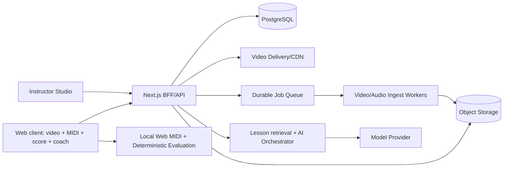

# Technical architecture — buildable and testable

## Overall topology



The music input and reactive note rendering stay client-side. Network requests should be for durable session results, content and conversational explanations, not note-by-note round trips. Domain APIs are typed and versioned. Choose one deployment region initially, subject to privacy and customer base.

## Proposed stack with rationale

- **Frontend:** Next.js App Router, React, TypeScript strict, Tailwind CSS, accessible headless component library, Zustand or equivalent small client-store for player state; server state via query library as needed. React UI must not rerender on every MIDI tick.
- **Music input:** Web MIDI API permission triggered by explicit UI action; handle `navigator.requestMIDIAccess` failure, device hotplug, sustain pedal, duplicate device names, note-on velocity zero meaning note-off; MIDI input metadata is not equal to note recognition from microphone.
- **Music timeline:** custom standalone `packages/music-core` TypeScript engine, pure functions and immutable events. Scheduler based on AudioContext clock / monotonic time, not `setInterval` as scoring source. Visualization updates via `requestAnimationFrame`; Canvas/WebGL renderer only when necessary.
- **Notation:** OpenSheetMusicDisplay for MusicXML; use a conversion/position mapping to highlight measures based on beat positions. If precise note-level cursor cannot be achieved, write an adapter with tests; don't fork prematurely.
- **Audio playback:** Tone.js or Web Audio with preloaded assets, user gesture unlocking, scheduled count-in/metronome and pitch-safe video playback speed policy. Reference video playback time and music timeline must be explicitly calibrated.
- **Backend:** Next.js route handlers or a separate API module if growth warrants; PostgreSQL, Prisma/Drizzle migrations; no untyped direct DB access from components.
- **Assets:** private S3-compatible object storage + signed URLs; processed streaming video through a managed video service (e.g. Mux/Cloudflare Stream after vendor review) and subtitles. Don't place raw videos in Git.
- **Jobs:** durable queue + idempotent workers for ingestion, transcription suggestions, embedding, thumbnails and content publication.
- **AI:** model-neutral orchestrator; retrieval from authorized lesson text and vetted concepts; structured tool calls and explicit scope; store evaluated performance as structured measurements, not prompts.
- **Auth/Billing:** managed authentication provider with verified sessions and server-side RBAC. Subscription webhook handling with deduplication; never gate content solely in frontend.
- **Observability:** structured logs, tracing, worker metrics, web performance, crash reports, content-processing audit; privacy-safe analytics with opt-out where required.

## Monorepo layout

```text
jazzverse/
  apps/web/                      # Student app and teacher studio
    app/(marketing)/
    app/(auth)/
    app/(student)/discover/
    app/(student)/courses/[slug]/
    app/(student)/lessons/[id]/
    app/(student)/practice/
    app/(student)/repertoire/
    app/(student)/progress/
    app/(student)/settings/
    app/(studio)/studio/lessons/
    app/api/v1/
  packages/ui/                   # Design system, mascot, cards, overlays
  packages/music-core/           # Timelines, MIDI, alignment, scoring, harmony
  packages/content-schema/       # Lesson manifests and Zod schemas
  packages/ai-coach/             # retrieval, prompts, tool definitions
  packages/shared/               # API types, utils, validation
  workers/ingest/                # Durable background media processing
  infra/                         # Infrastructure-as-code
  prisma/                        # SQL schema/migrations as selected
  tests/e2e/                     # Browser/device tests
  docs/                           # ADRs, runbooks, specs and artifacts
  product/                        # This implementation kit
```

## Domain entities (minimum viable schema)

- `User(id, authProviderId, role, locale, timezone, createdAt, deletedAt)`
- `StudentProfile(userId, stage, primaryGenre, goalsJson, assistantMode, assistantMuted)`
- `Instructor(id, userId, bio, profileAssetId)`
- `Course(id, slug, title, genre, instructorId, status, summary, level, publishedAt)`
- `CourseUnit(id, courseId, position, title)`
- `Lesson(id, courseUnitId, title, position, durationMs, status, version, manifestId, videoAssetId)`
- `VideoAsset(id, storageKey, providerAssetId, status, rightsId, durationMs, captionAssetId)`
- `LessonManifest(id, lessonId, version, musicXmlAssetId, midiAssetId, tempoMapJson, syncAnchorsJson, notationRevision)`
- `MusicEvent(id, manifestId, startBeat, durationBeats, midiPitch, velocity, hand, track)` (or immutable JSON blob + index)
- `Exercise(id, lessonId, type, startBeat, endBeat, rubricVersion, allowedVoicingsJson, targetSkillsJson)`
- `Enrollment(id, studentId, courseId, createdAt, lastLessonId)`
- `PracticeSession(id, studentId, lessonId, exerciseId, startedAt, endedAt, rubricVersion, calibrationId, status, idempotencyKey)`
- `PerformanceEvent(sessionId, timestampMs, midiStatus, pitch, velocity, channel, source)` (optional compacted private stream with retention)
- `AttemptResult(sessionId, scoreJson, noteMetricsJson, timingMetricsJson, evaluatorVersion, masteredSkillsJson)`
- `SkillDefinition(id, taxonomyVersion, parentId, title, genre)`
- `SkillEvidence(id, studentId, skillId, sessionId, confidence, observedAt)`
- `AssistantConversation(id, userId, lessonId, createdAt)`
- `AssistantMessage(id, conversationId, role, content, citedSegmentsJson, actionJson, createdAt)`
- `ContentSegment(id, lessonId, startMs, endMs, text, speaker, reviewedAt, embeddingRef)`
- `RightsRecord(id, assetId, rightsHolder, territory, usage, expiry, notes)`
- `Subscription(id, userId, provider, providerCustomerId, status, periodEnd)`
- `AuditLog(id, actorId, action, resourceId, timestamp, metadataJson)`

**Data rules:** keys are UUID/ULID; immutable published manifest versions; structured schemas with validation; row-level authorization on all student assets. Every score references evaluator version + source manifest version + device calibration profile.

## Critical API sketch

```text
GET    /api/v1/catalog?genre=jazz&query=...
GET    /api/v1/courses/:courseId
GET    /api/v1/lessons/:lessonId/player-manifest
POST   /api/v1/practice/sessions
POST   /api/v1/practice/sessions/:id/finish
GET    /api/v1/practice/sessions/:id/result
GET    /api/v1/progress/skills
GET    /api/v1/repertoire
POST   /api/v1/coach/messages                # structured context only
POST   /api/v1/coach/actions/:id/confirm    # explicit confirmation
POST   /api/v1/studio/lessons/import
POST   /api/v1/studio/lessons/:id/review
POST   /api/v1/studio/lessons/:id/publish
POST   /api/v1/webhooks/billing             # signature + replay protection
```

All endpoints require runtime validation (Zod or equivalent), auth, entitlement checks and error shapes. `GET player-manifest` must return only content the user may access; signed media URLs expire. Publish and admin calls enforce RBAC on server.

## Audio/video musical synchronization model

Each lesson manifest has tempo map, time signature map, note events in beats and at least 2 tested anchors mapping beat positions to video media timestamps. There are two modes:

- **Watch mode**: video media clock owns timeline; notation follows mapped beat. Pause seeks update display. Drift correction is visual and gentle.
- **Practice mode**: audio/musical clock owns timeline; video demonstration can be paused, trimmed, looped, or detached; video sync is attempted only if lesson configured for it.

Never claim simple fixed offset is enough for variable-tempo live jazz demonstrations. Segment-based anchor mapping and editorial sync review required; explicitly model rubato or tempo changes.

## Security/privacy

- HTTPS everywhere; minimal MIDI/raw-audio retention; transcript sensitive to students; AI may not train on user practice without explicit consent and contractual review.
- Signed upload and playback, EXIF/metadata stripping where appropriate, rate limiting, audit, safe server tool allowlists, provider key vault, GDPR access/deletion and retention policies.
- Treat course transcripts as data, not instructions; prompt-injection defenses; limit AI access to per-user authorized lesson and progress.
- Vendor DPA/subprocessor review for AI, payment, video and analytics providers. Rights and child protection requirements if marketed to children.

## Deployment sequence

Dev with seeded one-lesson fixture → preview deployment per pull request → staging with test Stripe and licensed private video → production release behind flags. Migrate database with rollback strategies, use backups + restore tests; instrument sync and MIDI device failures. Feature flags: `coach_enabled`, `voice_coach`, `audio_to_midi`, `jazz_harmony_rubric`, `virtual_band`.
